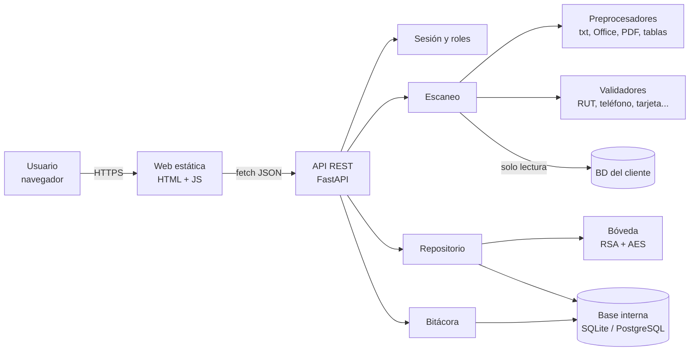

# K-Secure

**Detección y clasificación de datos sensibles chilenos en documentos y bases de datos.**

Proyecto de título (Capstone PTY4614) · Ingeniería en Informática · Duoc UC, sede Padre Alonso de Ovalle · Sección PTY4614-003 · Equipo 2

---

## Índice de evidencias

Dónde está cada documento que se revisa en el repositorio. Las rutas son relativas a la raíz.

### Documentación del proyecto

| Evidencia | Dónde está |
|---|---|
| **Documento de inicio de proyecto** | [`docs/00_Documento_Inicio_Proyecto.md`](docs/00_Documento_Inicio_Proyecto.md) (problema, justificación, objetivos, stakeholders, alcance del MVP, restricciones, riesgos y decisiones) · versión de la Fase 1: [`1.5_GuiaEstudiante_Fase1_DefinicionProyecto (1).docx`](<1.5_GuiaEstudiante_Fase1_DefinicionProyecto (1).docx>) |
| **Metodología declarada y justificada** | [`docs/agil/00_Metodologia.md`](docs/agil/00_Metodologia.md) (Scrum: justificación, roles, ceremonias y cadencia) · sección [Metodología](#metodología) de este README · Guía 1.5, sección 5 |
| **Product Vision** | [`docs/agil/01_Product_Vision.md`](docs/agil/01_Product_Vision.md) |
| **Product Backlog** | [`docs/agil/02_Product_Backlog.md`](docs/agil/02_Product_Backlog.md) |
| **Sprint Backlog** | [`docs/agil/03_Sprint_Backlog.md`](docs/agil/03_Sprint_Backlog.md) (incluye los commits de cada sprint) |
| **Definition of Done** (criterios de aceptación) | [`docs/agil/04_Definition_of_Done.md`](docs/agil/04_Definition_of_Done.md) · criterios por historia en el Product Backlog |
| **Retrospectivas** | [`docs/agil/05_Retrospectivas.md`](docs/agil/05_Retrospectivas.md) |
| **Especificación de requisitos (SRS / ERS)** | [`03 - Especificación de Requerimientos de Software (ERS).docx`](<03 - Especificación de Requerimientos de Software (ERS).docx>) · [`04 - Especificación de Casos de Uso.docx`](<04 - Especificación de Casos de Uso.docx>) · [`docs/Matriz_de_Trazabilidad.md`](docs/Matriz_de_Trazabilidad.md) (requisito → caso de uso → historia → código → prueba) |
| **README del repositorio** | Este archivo · README técnico de la app en [`k-secure-web/README.md`](k-secure-web/README.md) |
| **Arquitectura** | [`05 - Documento de Arquitectura de Software (SAD 4+1).docx`](<05 - Documento de Arquitectura de Software (SAD 4+1).docx>) · [`k-secure-web/docs/ARQUITECTURA.md`](k-secure-web/docs/ARQUITECTURA.md) · sección [Arquitectura](#arquitectura) de este README |
| **Modelo de datos** | [`docs/diagramas/01_Modelo_Entidad_Relacion.md`](docs/diagramas/01_Modelo_Entidad_Relacion.md) · tablas en [`k-secure-web/ksecure/almacenamiento/modelos.py`](k-secure-web/ksecure/almacenamiento/modelos.py) · base demo en [`k-secure-web/demo/cliente_demo.sql`](k-secure-web/demo/cliente_demo.sql) |
| **Diagramas UML** | Clases: [`docs/diagramas/02_UML_Diagrama_de_Clases.md`](docs/diagramas/02_UML_Diagrama_de_Clases.md) · Secuencia: [`docs/diagramas/03_UML_Diagrama_de_Secuencia.md`](docs/diagramas/03_UML_Diagrama_de_Secuencia.md) · Componentes y despliegue: [`docs/diagramas/04_UML_Diagrama_de_Componentes.md`](docs/diagramas/04_UML_Diagrama_de_Componentes.md) · Casos de uso: `04 - Especificación de Casos de Uso.docx` · Imágenes: [`docs/diagramas/img/`](docs/diagramas/img/) |
| **Requisitos no funcionales** | [`docs/Requisitos_No_Funcionales.md`](docs/Requisitos_No_Funcionales.md) (servidor, software, entorno) · RNF-01 a RNF-12 en la ERS |
| **Docker** | [`k-secure-web/Dockerfile`](k-secure-web/Dockerfile) · [`k-secure-web/docker-compose.yml`](k-secure-web/docker-compose.yml) · [`k-secure-web/.env.example`](k-secure-web/.env.example) |
| **Pruebas** | Plan: [`docs/Plan_de_Pruebas.md`](docs/Plan_de_Pruebas.md) · código: [`k-secure-web/tests/`](k-secure-web/tests/) (unitarias, [`integracion/`](k-secure-web/tests/integracion/), [`seguridad/`](k-secure-web/tests/seguridad/), [`rendimiento/`](k-secure-web/tests/rendimiento/)) |
| **Manual técnico** | [`docs/Manual_Tecnico.md`](docs/Manual_Tecnico.md) |
| **Innovación e impacto en el mercado** | [`docs/Innovacion.md`](docs/Innovacion.md) |
| Marco de clasificación de datos (objetivo OE5) | [`docs/Marco_de_Clasificacion_de_Datos.md`](docs/Marco_de_Clasificacion_de_Datos.md) |

### Entregas de la asignatura

| Entrega | Tipo | Dónde está |
|---|---|---|
| 1.1 Autoevaluación de competencias Fase 1 | Individual | Carpeta de cada integrante: `Autoevaluaciones <Nombre>/<Apellido>_<Nombre>_1.1_APT122_AutoevaluacionCompetenciasFase1.docx` |
| 1.2 Diario de reflexión Fase 1 | Individual | `Autoevaluaciones <Nombre>/<Apellido>_<Nombre>_1.2_APT122_DiarioReflexionFase1.docx` |
| 1.3 Autoevaluación Fase 1 | Individual | `Autoevaluaciones <Nombre>/<Apellido>_<Nombre>_1.3_APT122_AutoevaluacionFase1.docx` |
| Presentación del proyecto Fase 1 | Grupal | [`Presentacion_Proyecto_Fase1_K-Secure.pptx`](Presentacion_Proyecto_Fase1_K-Secure.pptx) |
| 1.4 Formativa Fase 1 | Grupal | [`1.4_Informe_kSecure_fase1.docx`](1.4_Informe_kSecure_fase1.docx) |
| 1.5 Definición del proyecto | Grupal | [`1.5_GuiaEstudiante_Fase1_DefinicionProyecto (1).docx`](<1.5_GuiaEstudiante_Fase1_DefinicionProyecto (1).docx>) |
| 2.1 Diario de reflexión Fase 2 | Individual | `Autoevaluaciones <Nombre>/<Apellido>_<Nombre>_2.1_APT122_DiarioReflexionFase2.docx` |
| 2.3 Informe de avance Fase 2 | Grupal | [`2.3_APT122_InformeAvance_Fase2_K-Secure.docx`](2.3_APT122_InformeAvance_Fase2_K-Secure.docx) |
| 2.4 Desarrollo del proyecto Fase 2 | Grupal | [`2.4_GuiaEstudiante_Fase2_DesarrolloProyecto_APT_COMPLETO.docx`](2.4_GuiaEstudiante_Fase2_DesarrolloProyecto_APT_COMPLETO.docx) |
| 2.6 Informe final Fase 2 | Grupal | [`2.6_GuiaEstudiante_Fase2_InformeFinal_APT_COMPLETO.docx`](2.6_GuiaEstudiante_Fase2_InformeFinal_APT_COMPLETO.docx) |
| Presentación del proyecto Fase 2 | Grupal | [`Presentacion_Proyecto_Fase2_K-Secure.pptx`](Presentacion_Proyecto_Fase2_K-Secure.pptx) |
| Autoevaluación Fase 2 | Individual | `Autoevaluacion_Fase2_<Nombre>.docx` (raíz) |

Carpetas de cada integrante: [`Autoevaluaciones Camilo Fuenzalida/`](<Autoevaluaciones Camilo Fuenzalida/>) ·
[`Autoevaluaciones Emanuel Farias/`](<Autoevaluaciones Emanuel Farias/>) ·
[`Autoevaluaciones Martin Campos/`](<Autoevaluaciones Martin Campos/>)

---

## Descripción

Las empresas chilenas guardan datos personales (RUT, celulares, tarjetas, cuentas bancarias, patentes, correos)
repartidos en planillas, documentos y bases de datos, muchas veces sin saber dónde están. Con la Ley 21.719 de
protección de datos personales, no saber dónde están esos datos es un riesgo legal y reputacional.

**K-Secure** es una aplicación web que **encuentra, clasifica y protege** esos datos:

- Escanea **archivos** (Word, Excel, PowerPoint, PDF, OpenDocument, CSV, TXT, JSON y bases SQLite) y **bases de datos**
  (PostgreSQL, MySQL/MariaDB, SQL Server y Oracle, siempre en **solo lectura**).
- Cada hallazgo tiene una **confianza** (HIGH / MEDIUM / LOW) y un **nivel de riesgo**
  (Público / Interno / Confidencial / Restringido).
- Los datos se muestran siempre **enmascarados** (`**.***.198-5`); el original queda **cifrado** y solo un auditor
  con su clave puede verlo, y queda registrado en la bitácora.
- Permite crear **reglas nuevas sin programar**, a partir de ejemplos del dato.

Es la capa de **clasificación** que alimenta a una solución DLP (prevención de fuga de datos): le dice a la empresa
*dónde* tiene datos sensibles, *de qué tipo* son y *qué tan grave* sería que se filtren.

El diseño del motor sigue a [ferret-scan](https://github.com/awslabs/ferret-scan) de AWS Labs (Apache 2.0),
adaptado a los datos chilenos. Qué lo hace diferente y su impacto en el mercado: [`docs/Innovacion.md`](docs/Innovacion.md).

---

## Tecnologías

| Capa | Tecnología |
|---|---|
| Lenguaje | Python 3.13 |
| Backend / API REST | FastAPI + Uvicorn, Pydantic |
| Base de datos interna | SQLAlchemy 2 sobre SQLite (local) o PostgreSQL (Neon en la nube) |
| Bases de datos del cliente | PostgreSQL (psycopg 3), MySQL/MariaDB (PyMySQL), SQL Server (pymssql), Oracle (oracledb) |
| Seguridad | cryptography (RSA-OAEP 2048 + AES/Fernet), bcrypt para contraseñas |
| Lectura de archivos | zipfile + ElementTree (Office/OpenDocument), pypdf, xlrd |
| Reportes | reportlab (PDF), CSV y JSON |
| Frontend | HTML5, CSS3 y JavaScript (módulos ES, sin frameworks) |
| Pruebas | pytest + httpx (unitarias, integración, seguridad y rendimiento) |
| Contenedores | Docker y Docker Compose |
| Nube | Render (aplicación) + Neon (PostgreSQL), región AWS us-east-2 |
| Control de versiones | Git + GitHub |

---

## Ejecución local

Requisitos: **Python 3.11 o superior** y Git. El código vive en la carpeta [`k-secure-web/`](k-secure-web/).

```bash
git clone https://github.com/Martin1421cl/Capstone.git
cd Capstone/k-secure-web
python -m venv .venv
.venv\Scripts\activate            # Linux/Mac: source .venv/bin/activate
pip install -r requirements.txt
uvicorn ksecure.web.app:app
```

Abrir http://localhost:8000. La primera vez se crea la **cuenta de administrador**; desde **Usuarios** se crean las
demás cuentas y la **clave de auditor** (sin ella no se puede escanear). La API queda documentada en
http://localhost:8000/docs.

**Con Docker** (incluye PostgreSQL y una base de cliente ficticio para la demo):

```bash
cd Capstone/k-secure-web
cp .env.example .env                       # cambiar las contraseñas
docker compose --profile demo up --build
```

**Pruebas:**

```bash
cd k-secure-web
pytest -v                                  # todas
pytest tests/integracion tests/seguridad   # solo integración y seguridad
```

Instalación detallada, variables de entorno, despliegue en la nube y solución de problemas:
[`docs/Manual_Tecnico.md`](docs/Manual_Tecnico.md).

---

## Integrantes y roles

| Integrante | Usuario GitHub | Rol en el equipo | Responsabilidades principales |
|---|---|---|---|
| **Camilo Fuenzalida** | `Fruna1` | Desarrollador principal · Arquitectura · Scrum Master | Arquitectura basada en ferret-scan, motor de escaneo, validadores chilenos, preprocesadores, escaneo de bases de datos, bóveda cifrada, mantenedor de reglas, despliegue en Render + Neon |
| **Emanuel Farías** | `Emanuel2234` | Desarrollador backend y web | Login con roles (Admin / Auditor / Visor), recuperación de contraseña, bitácora, exportación de resultados, revisión de hallazgos, cliente simulado |
| **Martín Campos** | `Martin1421cl` | Documentación y gestión del proyecto · Product Owner | Repositorio del equipo, documentación formal (ERS, casos de uso, arquitectura SAD), guías y entregas de cada fase, seguimiento del backlog |

**Docente:** Ceferino Aníbal Sotelo.

Los commits hechos con distintos usuarios o correos se unen bajo el nombre real de cada integrante con el archivo
[`.mailmap`](.mailmap) (`git shortlog -sn` muestra el aporte por persona).

---

## Metodología

El equipo trabaja con **Scrum adaptado** a un equipo de tres personas y a los plazos del semestre:

- **Sprints de 2 semanas**, alineados con las fases y entregas del Capstone.
- **Product Backlog** con historias de usuario priorizadas (MoSCoW) y estimadas en puntos de historia.
- **Reunión de planificación** al inicio de cada sprint, **seguimiento semanal** del avance y **retrospectiva** al cierre.
- **Definition of Done** común para todas las historias.

**Por qué Scrum:** el alcance cambió durante el proyecto (el docente pidió parecerse a ferret-scan, se descartó el
`.exe` y se rehízo el sistema como aplicación web). Una metodología en cascada habría obligado a rehacer el
análisis completo; con sprints cortos pudimos incorporar la retroalimentación del docente en el sprint siguiente y
entregar incrementos funcionales en cada fase.

Detalle completo (justificación frente a cascada y Kanban, roles, ceremonias y cadencia): [`docs/agil/00_Metodologia.md`](docs/agil/00_Metodologia.md).

Artefactos en [`docs/agil/`](docs/agil/):
[Product Vision](docs/agil/01_Product_Vision.md) ·
[Product Backlog](docs/agil/02_Product_Backlog.md) ·
[Sprint Backlog](docs/agil/03_Sprint_Backlog.md) ·
[Definition of Done](docs/agil/04_Definition_of_Done.md) ·
[Retrospectivas](docs/agil/05_Retrospectivas.md)

---

## Arquitectura

K-Secure es una aplicación web en capas. El motor sigue el diseño de ferret-scan: **preprocesadores** leen cada tipo
de archivo, **validadores** deciden qué es sensible y con qué confianza, y K-Secure agrega la clasificación de
riesgo, el almacenamiento cifrado y la web.



```
Capstone/
├── README.md                  ← este archivo
├── docs/
│   ├── 00_Documento_Inicio_Proyecto.md
│   ├── agil/                  ← metodología y artefactos Scrum
│   ├── diagramas/             ← modelo entidad-relación y diagramas UML
│   ├── Matriz_de_Trazabilidad.md
│   ├── Marco_de_Clasificacion_de_Datos.md
│   ├── Plan_de_Pruebas.md
│   ├── Requisitos_No_Funcionales.md
│   ├── Manual_Tecnico.md
│   └── Innovacion.md
├── render.yaml                ← despliegue en Render
├── .mailmap                   ← une los usuarios de Git de cada integrante
└── k-secure-web/              ← código de la aplicación
    ├── ksecure/
    │   ├── core/              ← modelos del dominio (Match, niveles de confianza y riesgo)
    │   ├── validators/        ← QUÉ es sensible
    │   ├── preprocessors/     ← CÓMO se lee cada archivo
    │   ├── escaneo/           ← QUÉ se escanea (archivos y bases de datos)
    │   ├── almacenamiento/    ← DÓNDE se guarda (base interna, bóveda, usuarios, bitácora)
    │   └── web/               ← API REST y páginas
    ├── tests/                 ← unitarias, integracion/, seguridad/, rendimiento/
    ├── demo/                  ← base de un cliente ficticio
    ├── Dockerfile
    └── docker-compose.yml
```

Documentación de arquitectura:

- [`k-secure-web/docs/ARQUITECTURA.md`](k-secure-web/docs/ARQUITECTURA.md): decisiones de diseño y cómo se construyó.
- `05 - Documento de Arquitectura de Software (SAD 4+1).docx`: vistas 4+1.
- [`docs/diagramas/`](docs/diagramas/): modelo entidad-relación, diagramas de clases, secuencia y componentes.

Documentación de requisitos: `03 - Especificación de Requerimientos de Software (ERS).docx` (incluye los requisitos
no funcionales) y `04 - Especificación de Casos de Uso.docx`.
