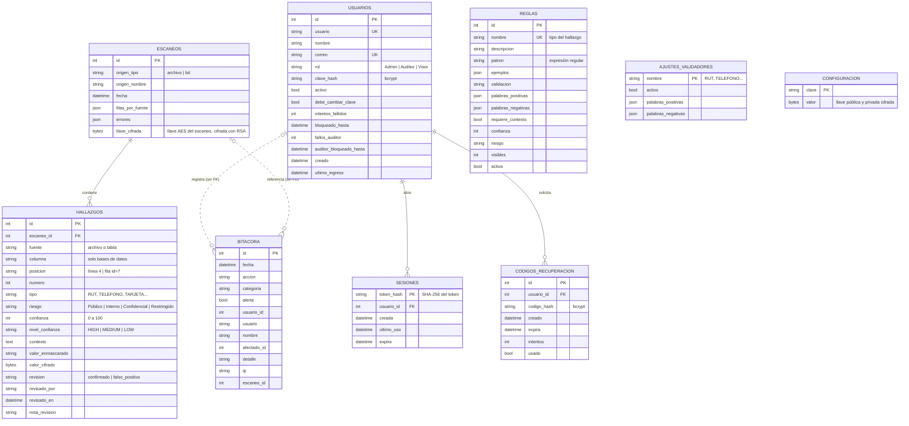
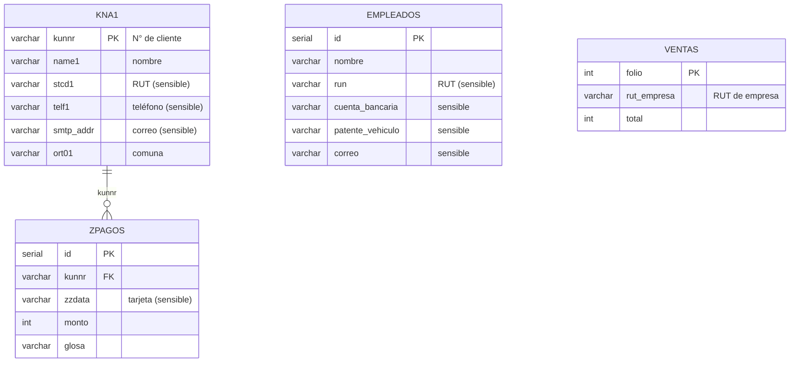

# Modelo de datos (diagrama entidad-relación) — K-Secure

K-Secure tiene **dos tipos de base de datos**:

1. **Base interna**: la de K-Secure. Guarda escaneos, hallazgos, reglas, cuentas y bitácora. Es SQLite en un PC
   y PostgreSQL (Neon) en la nube; las tablas se definen con SQLAlchemy en
   `k-secure-web/ksecure/almacenamiento/modelos.py`.
2. **Base del cliente**: la que se escanea, siempre en solo lectura. Para la demo se usa
   `k-secure-web/demo/cliente_demo.sql` (empresa ficticia con datos sintéticos).

> **Regla de oro del modelo:** el dato original **nunca** se guarda en claro. Cada hallazgo tiene
> `valor_enmascarado` (para mostrar) y `valor_cifrado` (para el auditor con la clave).

---

## 1. Base interna de K-Secure

### Descripción de las entidades

| Tabla | Para qué sirve | Relaciones |
|---|---|---|
| `escaneos` | Un escaneo de archivos o de una base de datos | 1 escaneo → N hallazgos (borrado en cascada) |
| `hallazgos` | Cada dato sensible encontrado, enmascarado y cifrado | N hallazgos → 1 escaneo |
| `usuarios` | Cuentas para entrar a K-Secure (las crea un Admin) | 1 usuario → N sesiones y N códigos |
| `sesiones` | Sesión abierta en un navegador; solo se guarda el hash del token | N sesiones → 1 usuario (cascada) |
| `codigos_recuperacion` | Código de 6 dígitos para recuperar la contraseña | N códigos → 1 usuario (cascada) |
| `bitacora` | Quién hizo qué y cuándo; solo se agregan filas | **Sin llaves foráneas a propósito**: el evento se conserva aunque se borre el escaneo o la cuenta |
| `reglas` | Detectores creados desde la pantalla Reglas | Independiente |
| `ajustes_validadores` | Validadores incluidos apagados o con palabras extra | Independiente |
| `configuracion` | Llaves de la bóveda (RSA) | Independiente |

### Decisiones de diseño

- **Cifrado híbrido:** cada escaneo tiene su propia llave AES (`escaneos.llave_cifrada`), cifrada con la llave
  pública RSA de `configuracion`. Para ver un original se necesita la clave de auditor, que descifra la llave privada.
- **Contraseñas y tokens nunca en claro:** `clave_hash` y `codigo_hash` con bcrypt; `token_hash` con SHA-256.
- **Índices** en `hallazgos.tipo`, `hallazgos.riesgo`, `hallazgos.revision` y `bitacora.fecha` para que los filtros
  de la pantalla Resultados y Bitácora respondan rápido con miles de filas.
- **Campos JSON** (`palabras_positivas`, `errores`...) para listas que se leen completas y no se consultan por partes.

---

## 2. Base del cliente simulado (demo)

Empresa ficticia con tablas al estilo SAP. K-Secure debe encontrar los datos sensibles **aunque el nombre de la
columna no lo diga** (por ejemplo `stcd1` es el RUT y `zzdata` guarda tarjetas).

---

**Versión en imagen** (para pegar en informes y presentaciones): [`er_base_interna.png`](img/er_base_interna.png) · [`er_cliente_demo.png`](img/er_cliente_demo.png)
