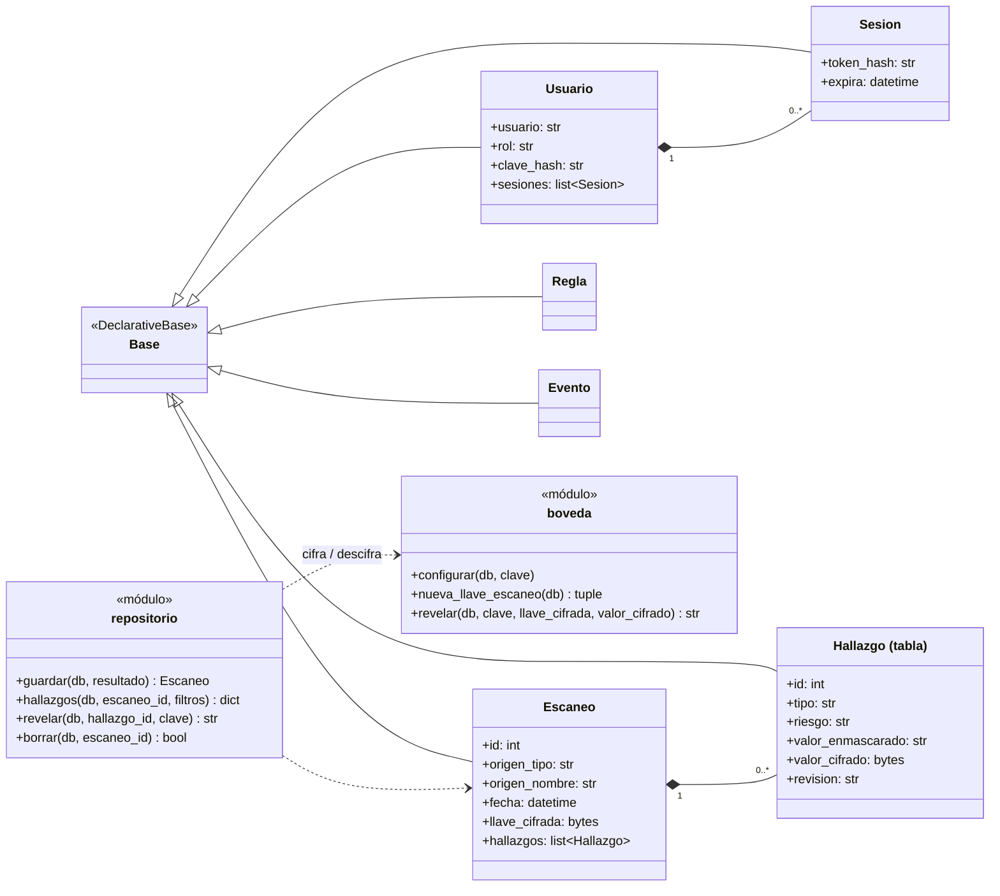

# Diagrama de clases (UML) — K-Secure

Clases principales del motor de detección. El diseño sigue a ferret-scan: un **router** de preprocesadores
convierte cada archivo en texto, y una lista de **validadores** (patrón *Strategy*) recorre ese texto. Todos los
validadores heredan de `Validator`, así que agregar un tipo de dato nuevo no exige cambiar el motor
(principio abierto/cerrado).

Código: `k-secure-web/ksecure/core`, `validators`, `preprocessors` y `escaneo`.

```mermaid
classDiagram
    direction TB

    class ConfidenceLevel {
        <<enumeration>>
        HIGH
        MEDIUM
        LOW
        +from_score(score) ConfidenceLevel
    }
    class RiskLevel {
        <<enumeration>>
        PUBLICO
        INTERNO
        CONFIDENCIAL
        RESTRINGIDO
    }
    class ContextInfo {
        +before_text: str
        +after_text: str
        +full_line: str
        +positive_keywords: list
        +negative_keywords: list
        +confidence_impact: float
    }
    class Match {
        +text: str
        +type: str
        +confidence: float
        +risk_level: RiskLevel
        +line_number: int
        +filename: str
        +validator: str
        +context: ContextInfo
        +metadata: dict
        +masked_text: str
        +confidence_level() ConfidenceLevel
    }
    class Candidate {
        +start: int
        +end: int
        +confidence: float
        +metadata: dict
        +requires_context: bool
    }

    class Validator {
        <<abstract>>
        +name: str
        +positive_keywords: tuple
        +negative_keywords: tuple
        +context_window: int
        +requires_context: bool
        +find_candidates(line)* Iterable~Candidate~
        +risk_level(confidence, metadata) RiskLevel
        +mask(text, metadata) str
        +validate_content(content, filename, hint) list~Match~
        +extract_context(line, start, end, hint) ContextInfo
    }
    class RutValidator {
        +find_candidates(line)
    }
    class TelefonoValidator
    class TarjetaValidator {
        +find_candidates(line)
        +mask(text, metadata)
        +risk_level(confidence, metadata)
    }
    class EmailValidator
    class CuentaBancariaValidator
    class PatenteValidator
    class SecretoValidator
    class ReglaValidator {
        +parametros: ParametrosRegla
    }
    class ParametrosRegla {
        +nombre: str
        +patron: str
        +validacion: str
        +palabras_positivas: tuple
        +palabras_negativas: tuple
        +requiere_contexto: bool
        +confianza: int
        +riesgo: RiskLevel
        +visibles: int
    }

    class Preprocessor {
        <<abstract>>
        +name: str
        +processor_type: str
        +extensions: tuple
        +can_process(path) bool
        +extract(path)* tuple
        +process(path) ProcessedContent
    }
    class PlainTextPreprocessor
    class OfficeTextPreprocessor
    class OfficeMetadataPreprocessor
    class PdfTextPreprocessor
    class PdfMetadataPreprocessor
    class ProcessedContent {
        +filename: str
        +text: str
        +format: str
        +processor_type: str
        +page_count: int
        +success: bool
        +error: str
        +metadata: dict
        +sections: list~Section~
    }
    class Section {
        +name: str
        +start: int
        +end: int
    }

    class Hallazgo {
        +match: Match
        +fuente: str
        +posicion: str
        +columna: str
        +numero: int
    }
    class ResultadoEscaneo {
        +origen_tipo: str
        +origen_nombre: str
        +hallazgos: list~Hallazgo~
        +filas_por_fuente: dict
        +errores: list
    }

    Validator <|-- RutValidator
    Validator <|-- TelefonoValidator
    Validator <|-- TarjetaValidator
    Validator <|-- EmailValidator
    Validator <|-- CuentaBancariaValidator
    Validator <|-- PatenteValidator
    Validator <|-- SecretoValidator
    Validator <|-- ReglaValidator
    ReglaValidator *-- ParametrosRegla

    Preprocessor <|-- PlainTextPreprocessor
    Preprocessor <|-- OfficeTextPreprocessor
    Preprocessor <|-- OfficeMetadataPreprocessor
    Preprocessor <|-- PdfTextPreprocessor
    Preprocessor <|-- PdfMetadataPreprocessor
    Preprocessor ..> ProcessedContent : crea
    ProcessedContent *-- Section

    Validator ..> Candidate : busca
    Validator ..> Match : crea
    Match *-- ContextInfo
    Match --> RiskLevel
    Match ..> ConfidenceLevel

    ResultadoEscaneo *-- Hallazgo
    Hallazgo *-- Match
```

---

## Clases de persistencia (SQLAlchemy)

Las entidades de la base interna (ver [modelo entidad-relación](01_Modelo_Entidad_Relacion.md)) son clases
mapeadas con SQLAlchemy. El `repositorio` convierte un `ResultadoEscaneo` en memoria en filas `Escaneo` y
`Hallazgo`, cifrando cada original con la `boveda`.

---

**Versión en imagen** (para pegar en informes y presentaciones): [`clases_motor.png`](img/clases_motor.png) · [`clases_persistencia.png`](img/clases_persistencia.png)
