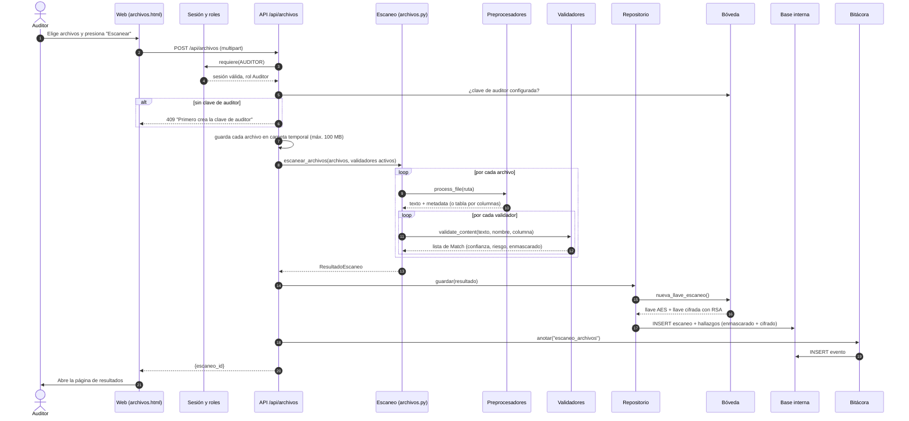
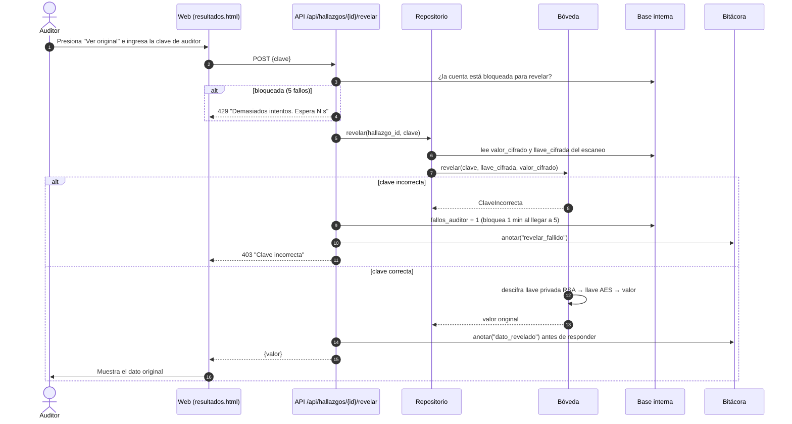
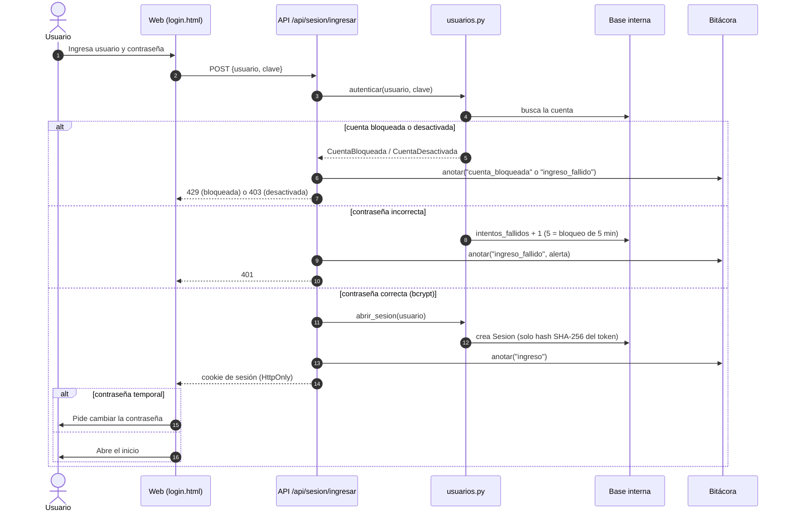

# Diagramas de secuencia (UML) — K-Secure

Tres flujos principales, tal como están implementados en `k-secure-web/ksecure/web/api/`.

---

## 1. Escanear archivos (CU-01)

El auditor sube uno o varios archivos. K-Secure los guarda en una carpeta temporal con un nombre propio (el nombre
del usuario nunca decide la ruta), los escanea, cifra cada original y borra los temporales.

---

## 2. Revelar un dato original (CU-04)

---

## 3. Iniciar sesión (CU-08)

---

**Versión en imagen** (para pegar en informes y presentaciones): [`secuencia_escanear_archivos.png`](img/secuencia_escanear_archivos.png) · [`secuencia_revelar_dato.png`](img/secuencia_revelar_dato.png) · [`secuencia_iniciar_sesion.png`](img/secuencia_iniciar_sesion.png)
