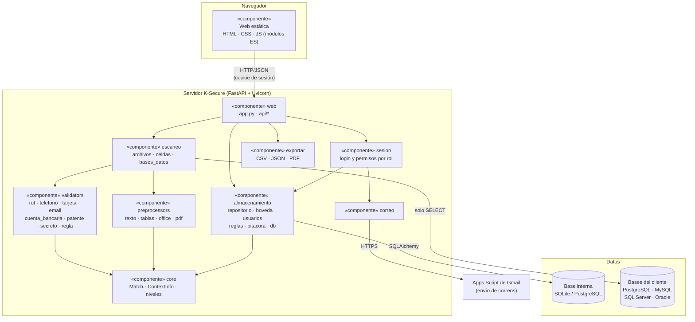
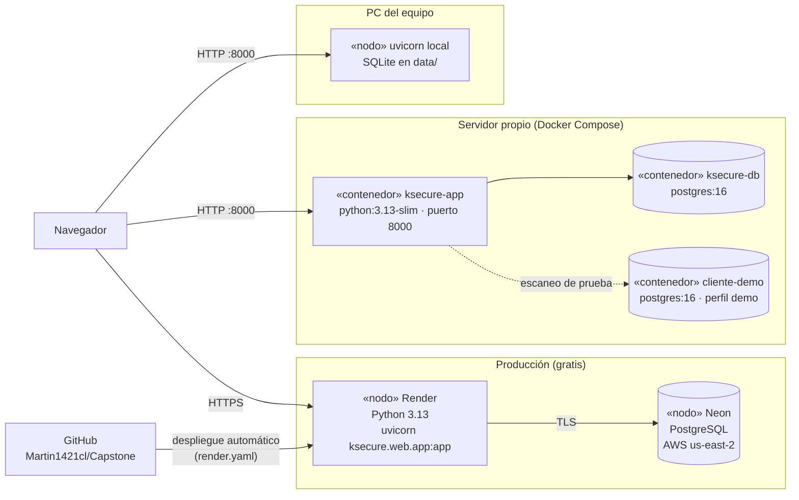

# Diagrama de componentes y despliegue (UML) — K-Secure

---

## 1. Componentes

Cada paquete de `k-secure-web/ksecure/` es un componente con una responsabilidad. Las dependencias van en un solo
sentido: la web usa el escaneo y el almacenamiento, el escaneo usa preprocesadores y validadores, y el núcleo
(`core`) no depende de nadie.

| Componente | Interfaz que ofrece | Depende de |
|---|---|---|
| `web` | API REST `/api/*` y páginas estáticas | sesion, escaneo, almacenamiento, exportar |
| `sesion` | `requiere(rol)` para cada endpoint | almacenamiento (usuarios) |
| `escaneo` | `escanear_archivos()`, `escanear_bd()` → `ResultadoEscaneo` | preprocessors, validators |
| `preprocessors` | `process_file(ruta)` → `ProcessedContent` | core |
| `validators` | `Validator.validate_content()` → `list[Match]` | core |
| `almacenamiento` | `repositorio`, `boveda`, `usuarios`, `reglas`, `bitacora` | base interna |
| `exportar` | `a_csv()`, `a_json()`, `a_pdf()` | reportlab |
| `correo` | `Correo.enviar()` | Apps Script (HTTPS) |

---

## 2. Despliegue

K-Secure se puede desplegar de tres formas con el mismo código.

---

**Versión en imagen** (para pegar en informes y presentaciones): [`componentes.png`](img/componentes.png) · [`despliegue.png`](img/despliegue.png)
